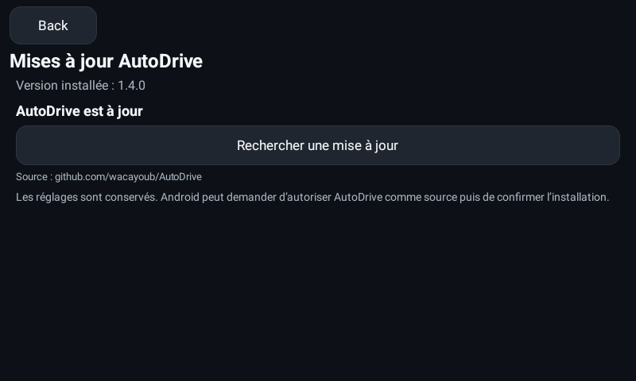
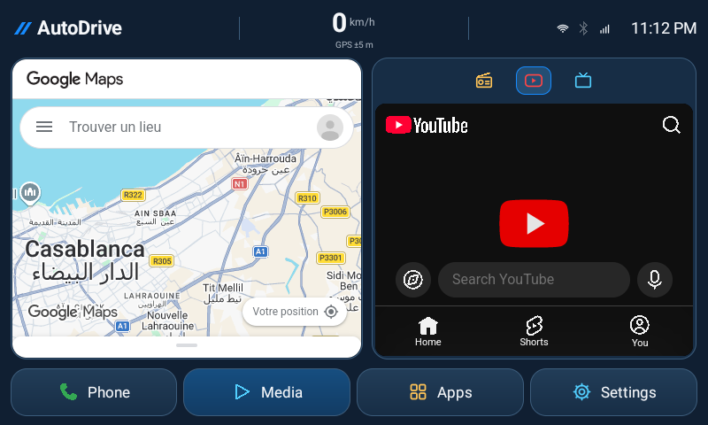
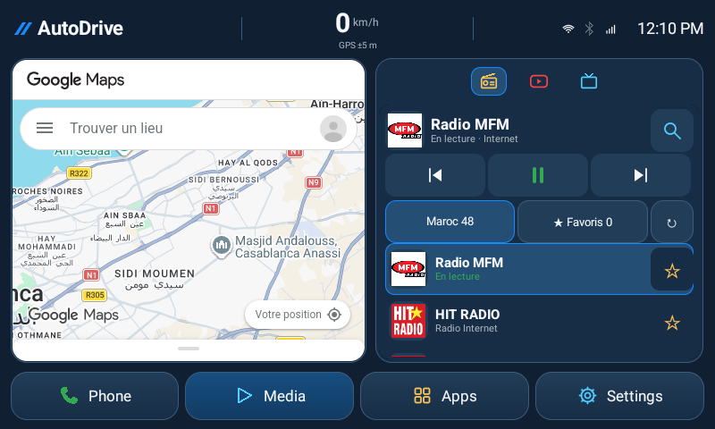
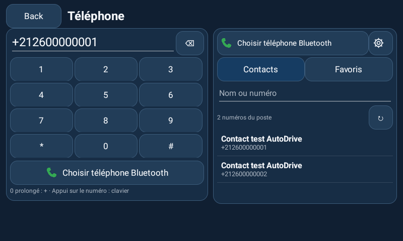
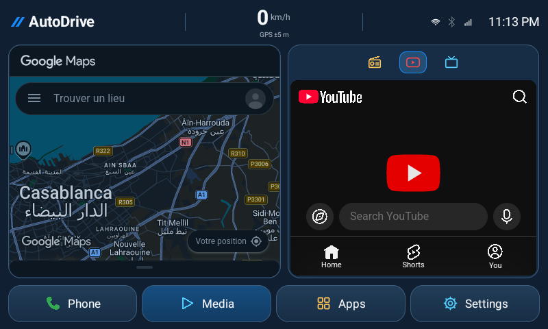

# AutoDrive

Lanceur Android 13 natif Kotlin pour Incarlink Max X15-SLM927-72, adapté au paysage 800 × 480 et au portrait sur téléphone. Carte Google et page d’accueil YouTube dans deux panneaux web officiels ; quatre raccourcis : Phone, Media, Apps, Settings.

**[Télécharger la dernière version](https://github.com/wacayoub/AutoDrive/releases/latest/download/AutoDrive.apk)** · [Versions et contrôles SHA-256](https://github.com/wacayoub/AutoDrive/releases) · [Tests](docs/TEST-RESULTS.md)

## Installation et mises à jour

1. Installe une première fois la version **1.4.0 ou ultérieure** depuis GitHub, en mise à jour de ton APK existant. Garde les données de l’application.
2. Ensuite ouvre **Settings → Mises à jour** dans AutoDrive : **Rechercher**, **Télécharger**, puis **Installer**. Tu n’as plus à chercher ni transférer chaque APK manuellement.
3. Android peut demander d’autoriser AutoDrive comme source d’installation et de confirmer la mise à jour. L’application ne contourne pas ces confirmations et n’installe rien silencieusement.

La même identité de signature est conservée pour permettre les mises à jour et garder les préférences. Le fichier téléchargé est contrôlé : SHA-256, taille, nom de package, version croissante et certificat Android. [Fonctionnement et publication](docs/ONLINE-UPDATES.md).



## Tableau de bord

- Version **1.7.0** : clavier Téléphone corrigé, contacts du poste avec recherche et préférence automatique pour BT Phone lorsque présent. Le carnet Bluetooth privé et les appels restent dans l’application constructeur ; aucune synchronisation Bluetooth directe n’est revendiquée. [Audit Téléphone Incarlink](docs/PHONE-INCARLINK-AUDIT.md).

- Version **1.6.2** : conservation des cookies des panneaux Maps/YouTube renforcée, avec acceptation explicite des cookies tiers et enregistrement sur disque à la sortie. Les cookies de test ont survécu à un arrêt complet ; la connexion réelle du propriétaire à Google reste à confirmer. Les sessions de Chrome et des applications installées restent séparées. [Fonctionnement et limites](docs/WEB-SESSIONS.md).
- Version **1.6.1** : liste Radio directement dans l’accueil avec logos disponibles, station active surlignée, filtres Maroc/Favoris et liste agrandie avec recherche. Les boutons précédente/suivante parcourent maintenant tout le catalogue chargé ou les favoris sélectionnés, même avec une seule station enregistrée auparavant. La pause fonctionne aussi pendant la connexion. [Audit et corrections Radio](docs/RADIO-AUDIT.md).
- Radio Internet native : catalogue marocain Radio Browser mémorisé, favoris et écoute audio. HIT RADIO est disponible par défaut ; les flux et logos restent soumis à leur disponibilité réelle. Aucun logo n’est inventé : une image absente ou inaccessible est remplacée par les initiales de la station.
- **Phone** propose un clavier corrigé, les contacts accessibles sur le poste et six favoris. BT Phone est prioritaire en mode Automatique lorsqu’il est détecté. Les appels et le carnet Bluetooth privé restent gérés par l’application d’origine ; [audit et limites](docs/PHONE-INCARLINK-AUDIT.md). [Fonctionnement Radio et Téléphone](docs/RADIO-PHONE.md).
- Depuis **1.5.1**, la carte Google Maps interactive reste directement dans l’accueil, comme en 1.4.2. Le raccourci natif plein écran de 1.5.0 est retiré. Recherche et zoom restent dans le panneau web ; YouTube reste visible à côté en paysage.
- Thème **Bleu profond** renforcé, compteur centré et icônes colorées (Téléphone vert, YouTube rouge, IPTV cyan). Les onglets média ont une petite surface de 40 × 32 dp, avec une cible tactile d’au moins 48 dp. Leur nom reste accessible aux lecteurs d’écran et par appui long.
- Maps suit le mode jour/nuit Android. La nuit, un traitement visuel du panneau complet assombrit aussi les tuiles et conserve des libellés contrastés. Il s’agit d’une adaptation d’affichage du navigateur, pas du thème natif Google Maps. L’invitation connue « Ouvrir l’appli » est masquée sur les pages Maps, sans supprimer les mentions Google ni les commandes de carte.
- Maps et YouTube s’ouvrent directement sur leurs sites officiels. Recherche de lieux, déplacement et zoom de carte, recherche YouTube et lecture vidéo ont été observés sur émulateur.
- Portrait : panneaux superposés et libellés complets. Paysage : deux panneaux côte à côte. La saisie au clavier donne la place nécessaire à la page utilisée.
- **Settings → Application YouTube** permet de choisir l’application installée pour une ouverture externe explicite. Le panneau YouTube garde sa page web. IPTV et l’option Radio externe lancent les applications choisies dans Settings.
- Le compteur utilise la localisation Android, avec `--` lorsque la vitesse n’est pas disponible. Aucune vitesse, instruction de navigation ou ETA n’est inventée.









Les panneaux ne sont pas des activités natives Google Maps/YouTube intégrées, ni Android Auto. Le guidage vocal complet peut demander l’application Maps. Les recommandations et la connexion au compte YouTube dépendent du service ; le navigateur intégré ne copie pas les comptes des applications installées. Voir [l’audit web](docs/WEB-DASHBOARD-AUDIT.md) et [l’audit navigation](docs/NAVIGATION-AUDIT.md).

## Compiler

Un [APK de diagnostic natif séparé](native-maps-test/README.md) vérifie les préconditions publiques d’intégration de Google Maps Android. L’essai sur émulateur n’a pas obtenu d’intégration native ; cet APK ne remplace pas le tableau de bord et n’est pas distribué par son canal de mise à jour stable.

JDK 17, SDK Android Platform 35, Build Tools 35, Gradle Wrapper fourni. Configure `JAVA_HOME` et `ANDROID_HOME`, ou laisse Android Studio créer `local.properties`.

```sh
./gradlew :app:testDebugUnitTest :app:lintDebug :app:assembleDebug
```

Les APK de test ont une signature locale et ne remplacent pas les releases officielles si la clé locale diffère. Pour une release compatible, configure les variables `AUTODRIVE_KEYSTORE_FILE`, `AUTODRIVE_KEYSTORE_PASSWORD`, `AUTODRIVE_KEY_ALIAS`, `AUTODRIVE_KEY_PASSWORD`, puis utilise `:app:assembleRelease`. La clé privée n’est jamais publiée dans Git.

## Publier une version

Augmente `versionCode` et `versionName` dans `app/build.gradle`, pousse sur `main`, puis lance **Actions → Signed Android release**. Le workflow teste, compile, signe, contrôle le certificat et publie les fichiers de mise à jour. [Guide de publication](docs/ONLINE-UPDATES.md).

Le dépôt contient le projet Android Studio et les tests. Les photos fournies par le propriétaire, les sauvegardes de firmware, les pièces jointes privées et les anciennes archives APK ne sont pas publiées dans Git.

L’application ne flashe aucun firmware, ne modifie aucun ECU et ne remplace pas les applications Toyota. L’installation sur le boîtier reste une action du propriétaire. Les validations sur émulateur et les limites matérielles sont consignées dans [les résultats de tests](docs/TEST-RESULTS.md).
