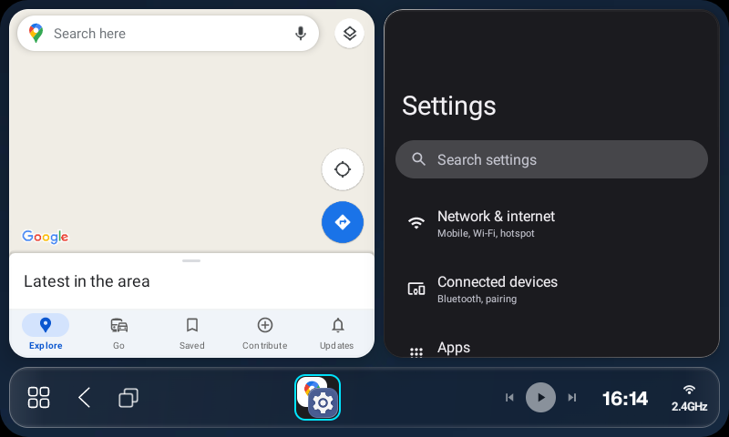

# Thème bleu graphite AutoDrive pour AB Launcher

Le fond 800 × 480 reprend le bleu `#101F32` et la surface `#172D45` d’AutoDrive. Les réglages utilisent les menus d’AB Launcher 1.5.7. [Fond PNG à télécharger](../deliverables/autodrive-ab-background-800x480.png)

1. Télécharge le PNG sur le boîtier. Dans **Settings → Display → Background**, touche **+**, sélectionne le PNG et valide le cadrage avec **Apply**.
2. Dans **Display mode**, choisis **Dark** et applique. Garde le thème **CarPlay**. Dans **CarPlay shape**, touche **Default** pour obtenir des coins de **16 dp** et un espacement de **7 dp**.
3. Dans **Settings → Sidebar**, choisis **Bottom** et règle **Sidebar size** autour de **70 %**. Dans **Settings → System**, désactive **Top clock** et active **Show clock on sidebar** pour libérer les commandes en haut de Maps.
4. Fais glisser le séparateur pour donner environ **52 %** de la largeur à Maps et **48 %** à l’autre application. Choisis les applications installées dans les deux panneaux et enregistre la disposition avec **+**. Pour la retrouver au lancement d’AB, sélectionne-la dans **Settings → Startup → Startup screen**.

Les options de forme et de disposition dépendent de la version et de l’offre d’AB Launcher. Le test a été réalisé pendant son mode Beta. [Manuel AB Launcher](https://marrusoft.com/en/manual/kr)

Chaque application choisit le thème à l’intérieur de son panneau. Pour harmoniser les couleurs, active le thème sombre dans le menu de profil de Maps et dans **Paramètres → Général → Apparence** de YouTube officiel. Maps propose aussi un réglage séparé pour les couleurs du guidage. Les menus de YouTube Advanced dépendent de la variante installée. [Aide Maps](https://support.google.com/maps/answer/10189433?hl=fr) · [Aide YouTube](https://support.google.com/youtube/answer/7385323?co=GENIE.Platform%3DAndroid&hl=fr)

Le fond, le mode sombre, la barre inférieure et la disposition **52:48** ont été vérifiés après un arrêt complet et une relance d’AB Launcher sur un émulateur Android 13 en 800 × 480. La capture montre Google Maps et les Paramètres Android comme deuxième application de test. Le fond cartographique reste vide dans cet environnement. [Résultats des essais d’applications natives](NAVIGATION-AUDIT.md#emulator-trial-of-ab-launcher-157)

