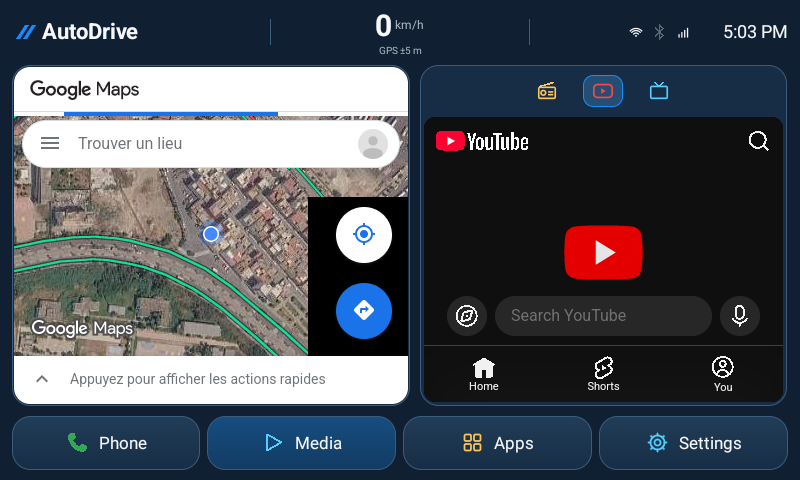

# Affichage Maps mémorisé — 1.11.1

Le propriétaire devait resélectionner « Votre position », le trafic et ses options après chaque redémarrage d’AutoDrive. Le correctif concerne le **panneau web Google Maps existant**. Il n’intègre pas l’activité Maps Android, Android Auto ou le Navigation SDK.

## Causes trouvées

- Les WebViews conservés depuis 1.8.0 gardent leur document pendant une simple visite de Radio/Réglages ou d’une autre application. En revanche, un nouveau processus reconstruisait Maps depuis l’adresse d’accueil par défaut. `WebView.saveState()` ne sauvegarde pas l’état visuel vivant ; Android le précise pour [saveState/restoreState](https://developer.android.com/reference/android/webkit/WebView#saveState(android.os.Bundle)).
- L’autorisation de géolocalisation du site utilisait `retain=false`. [L’API Android](https://developer.android.com/reference/android/webkit/GeolocationPermissions.Callback#invoke(java.lang.String,boolean,boolean)) distingue explicitement l’autorisation de la page courante et sa conservation.
- Lorsqu’Android n’avait pas encore accordé la localisation, le code refusait immédiatement la requête du site puis demandait l’autorisation système. Même après accord, la requête de position initiale avait déjà échoué.

## Ce qui est mémorisé

AutoDrive conserve un petit état privé : les choix reconnus **trafic, transports, vélo, satellite, relief, feux de forêt et commandes de mouvement de la carte**, le zoom et le recentrage au démarrage demandé par « Votre position ». Les libellés reconnus sont anglais, français et une sélection de libellés arabes. Le site peut changer ses libellés ou ne pas offrir une option ; une commande inconnue n’est pas actionnée au hasard.

Les contrôles de carte existants restent utilisés. Aucun bouton n’est ajouté sur la carte, aucune tuile n’est téléchargée séparément et aucun trafic, ETA, parcours ou position n’est inventé. Les [Maps URLs documentées](https://developers.google.com/maps/documentation/urls/get-started#displaying-a-map) permettent d’ouvrir une carte avec type/couche/zoom. Les autres choix reconnus sont rejoués par les propres cases de présentation du site, seulement si leur état diffère du choix mémorisé. Une commande reste limitée à trois tentatives par document, avec une attente totale bornée à trente secondes. La position attend d’abord 1,5 seconde puis espace les éventuelles relances de cinq secondes, uniquement si le bouton est toujours inactif. Une activation observée arrête les relances ; les actions manuelles interrompent toute la restauration.

Au premier usage après la mise à jour, sélectionner les options souhaitées et toucher « Votre position » **une dernière fois**. Elles pourront ensuite être reprises au démarrage. Les réglages qui n’avaient jamais été enregistrés par les anciennes versions ne peuvent pas être récupérés rétroactivement.

## Position, zoom et permission

- « Votre position » mémorise le souhait de se recentrer au prochain démarrage. La page doit redemander sa **position actuelle** au système ; les coordonnées précédentes ne sont pas réutilisées comme position actuelle.
- Quand le recentrage est actif, seuls le zoom et les choix d’affichage sont retenus : AutoDrive n’écrit pas des coordonnées à chaque mouvement de la voiture. Si le recentrage est désactivé, une seule vue de carte publique peut être conservée pour retrouver le cadrage manuel. Ce n’est pas un historique de trajets.
- Le zoom initial est retransmis au site. Le propre bouton de position de Google peut ensuite ajuster le zoom ou le cadrage ; AutoDrive ne le remplace pas par un moteur de carte privé.
- L’autorisation de site est retenue uniquement pour les origines HTTPS Google Maps exactes, après permission de localisation Android. Une origine de compte, un autre hôte, des identifiants dans l’URL ou un port inattendu sont refusés. Si la permission Android manque, le résultat est différé jusqu’au retour de la demande système ; refus et annulation ne sont pas mémorisés comme un accord.
- Le recentrage automatique n’est tenté que si la permission Android et la localisation système sont disponibles. Un GPS indisponible ou refusé ne produit pas une position simulée. Le compteur de vitesse conserve son fonctionnement séparé.
- **Réglages → Recentrage Maps au démarrage** permet de désactiver ou réactiver ce comportement. **Réinitialiser l’affichage Maps** efface uniquement cet état d’affichage et recharge la carte ; les comptes/cookies ne sont pas supprimés.

## Limites et données

Le code ne lit ni cookies, ni mots de passe, ni stockage de compte du site. Il ne copie pas la session d’une application ou d’un navigateur. Les paramètres d’authentification et de suivi ne sont pas conservés dans la vue enregistrée. Une URL de lieu/itinéraire ne contribue qu’à son cadrage numérique ; aucune navigation n’est redémarrée automatiquement. Le partage de position en temps réel, la connexion, les confirmations, la confidentialité et les paramètres de compte sont exclus des actions restaurées.

Les écritures sont limitées aux changements de cet état privé. Les observations se font pendant l’affichage ou la mise en pause du panneau, sans service permanent. Un arrêt forcé au milieu d’une interaction avant son enregistrement peut perdre le tout dernier geste ; ce correctif ne promet pas une sauvegarde atomique de tout le document web. Internet et le fournisseur restent nécessaires pour afficher leurs données actuelles.

Les [résultats](TEST-RESULTS.md) distinguent les contrôles synthétiques de test, la persistance entre processus, la permission refusée et les essais sur la vraie page Google Maps. La connexion Google du propriétaire et le GPS matériel de l’Incarlink restent à valider sur le boîtier.

Capture réelle après redémarrage de l’émulateur Android 13 / 800 × 480 : satellite, trafic et commande de position actifs. La position est fournie par le GPS de test de l’émulateur à Casablanca ; ce n’est pas une mesure sur le véhicule.

