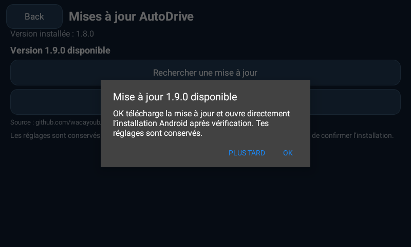
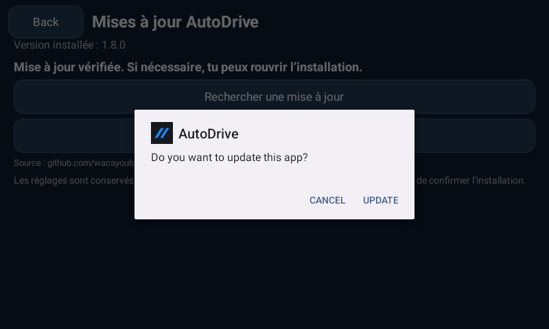

# GitHub and online updates

AutoDrive is distributed through **wacayoub/AutoDrive** GitHub Releases. From **1.9.1**, finding a newer compatible version displays an offer: **OK** starts the download, verifies the APK, then opens Android's installer without another in-app Install tap. **Plus tard** leaves it available under **Settings → Mises à jour → Mettre à jour maintenant**. Manual checking remains available. Older versions need their existing Download / Install sequence once to receive 1.9.1.

Android controls permission to install from AutoDrive and the installation confirmation. The app does not use root, Accessibility or firmware privileges to bypass that UI. It installs only after an explicit user action. The exact permission/installer UI on the Incarlink requires hardware validation. [Android installer requirements](https://developer.android.com/reference/android/content/pm/PackageInstaller.SessionParams#setRequireUserAction(int))

## Trust checks

- Requests use HTTPS, a fixed public GitHub repository and a bounded set of GitHub/CDN redirect hosts. No GitHub token is included in the Android app.
- Stable-release metadata names the package, increasing Android version code, Android compatibility, APK size and SHA-256 digest.
- Download size is bounded at 128 MiB, redirects and response sizes are bounded, partial downloads are removed, and the digest is checked.
- The downloaded package/version must match its metadata. Its current signing certificates must match the installed app. Android's package installer performs final platform installation validation.
- Verified files remain in the app's private update directory, exposed to the installer by a narrowly scoped FileProvider. No arbitrary source-code or signing-key directories are exposed.
- Settings and user data are retained by a normal in-place package update. A different signing key is rejected. Preserve the signing key for future releases.

The app checks at most once per day at foreground startup for each installed version. Checking and downloading can also be requested manually. It runs no permanent updater service, and it does not download or install silently in the background.

The offer appears once for the available version during the retained application session. One OK authorizes both the verified download and installer handoff; finding a release alone never starts its download. If the owner changes applications while downloading, the completed request waits for AutoDrive to return to the foreground before opening any installation UI. The request is consumed before opening Android, preventing installer loops after cancellation or return. **Reprendre l’installation** explicitly reopens the verified file. Unknown-source permission, if needed, leads to Android's settings; after granting it and returning, installation continues automatically. Denial leaves the file ready for a later retry. A process kill can interrupt the in-memory workflow; no unattended background recovery is promised.

Actual Android 13 emulator captures of the 1.9.1 implementation below use a deliberately lower **1.8.0 / code 23 test build** so the real signed public **1.9.0 / code 24** APK is a valid newer candidate. These are not a new 1.8.0 release, nor an owner-device installation.

## Publishing later versions

1. Increase `versionCode` and `versionName` in `app/build.gradle`, keeping the package name and signing identity.
2. Push the source to `main`. The Android checks workflow builds and runs JVM tests/lint.
3. Run **Actions → Signed Android release → Run workflow** on the reviewed branch. The workflow builds with the encrypted repository signing secrets, verifies the certificate, creates a draft release, uploads the APK/metadata/checksum, then publishes it as the latest release. It refuses to overwrite a previously published version.
4. Verify the release and check for updates in AutoDrive.

Release assets are **AutoDrive.apk**, **autodrive-update.json** and **SHA256SUMS.txt**. Metadata is extracted from the actual built APK by `tools/build_update_manifest.py`. GitHub's release API is the version discovery endpoint. [GitHub release API](https://docs.github.com/en/rest/releases/releases)

Signing material is kept outside Git in `.release-signing/` for local builds and in encrypted GitHub Actions secrets for CI. The existing signing identity is retained for compatibility with already installed debug builds. Never commit or publish the private keystore. The repository has no embedded API keys or GitHub credentials.

`tools/github_release.py` supports local publication through an authenticated Git Credential Manager session or a token supplied through the environment. It never prints credentials. Repository creation and signing-secret upload are separate explicit maintenance options; updating secrets locally requires PyNaCl. Actions needs only its built-in scoped token for release publication.
