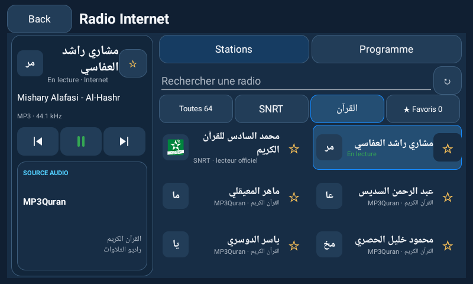
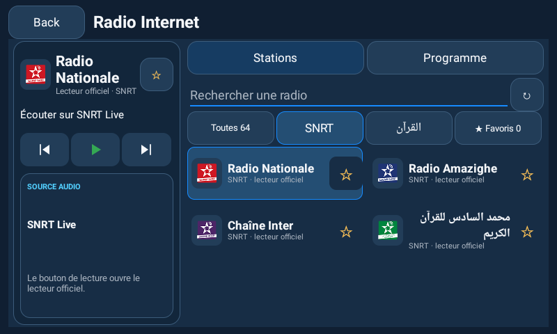
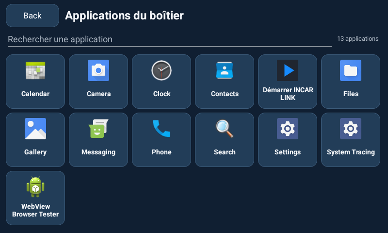

# Catalogue Radio et grille Applications — 1.10.0

## Ce qui est ajouté

Le catalogue marocain de Radio Browser est complété par une sélection embarquée, qui reste visible même sans annuaire : **quatre accès SNRT officiels** et **douze radios de récitation du Coran**. Les filtres Toutes / SNRT / القرآن / Favoris permettent de les retrouver sans parcourir toute la liste. Le choix du filtre est enregistré ; précédente/suivante suivent ce filtre. Un changement de filtre ne lance pas automatiquement de son ou d’application externe.

## SNRT : accès officiels, pas de faux flux natifs

| Nom affiché | Lecteur officiel |
| --- | --- |
| Radio Nationale | https://snrtlive.ma/fr/alidaa-alwatania |
| Radio Amazighe | https://snrtlive.ma/fr/alidaa-alamazighia |
| Chaîne Inter | https://snrtlive.ma/fr/chaine-inter |
| محمد السادس للقرآن الكريم | https://snrtlive.ma/fr/idaat-mohammed-assadiss |

Les quatre pages et leurs logos SNRT publics ont répondu HTTP 200 lors du contrôle du 6 novembre 2026. **Ce contrôle ne prouve pas la lecture audio sur le boîtier.** Toucher une entrée SNRT ou son bouton « Ouvrir le lecteur officiel SNRT » transmet la page à Android par un intent HTTPS standard : le navigateur ou une application associée gère l’écoute. AutoDrive n’annonce pas de lecture native, de pause ou de métadonnées qu’il ne reçoit pas. Passer sur une entrée SNRT avec précédente/suivante la sélectionne sans ouvrir spontanément une application ; son bouton ouvre explicitement le lecteur.

L’audit a trouvé les anciens liens HLS Akamai dans les pages institutionnelles SNRT, mais les quatre ont renvoyé HTTP 400. Les lecteurs SNRT Live actuels référencent EasyBroadcast avec un mécanisme de jetons temporaires. Un manifeste public consulté sans jeton a refusé l’accès ; une requête normale vers le service public de jeton a échoué HTTP 500. Aucun jeton n’est copié, inventé ou enregistré et aucun en-tête Origin/Referer n’est usurpé. Aucun adaptateur à ce protocole non vérifié n’est livré. Les anciennes URL défaillantes ne sont pas présentées comme des stations natives fonctionnelles.

Sources primaires inspectées : [SNRT Nationale](https://www.snrt.ma/fr/alidaa-alwatania), [Amazighe](https://www.snrt.ma/fr/alidaa-alamazighia), [Chaîne Inter](https://www.snrt.ma/fr/chaine-inter), [Mohammed VI](https://www.snrt.ma/fr/idaat-mohammed-assadiss), et leurs liens SNRT Live. Les radios régionales ne sont pas inventées à partir de chemins supposés.

## Récitation du Coran

La sélection utilise les flux HTTPS de l’[API radio officielle MP3Quran en arabe](https://www.mp3quran.net/api/v3/radios?language=ar), documentée dans l’[API publique](https://www.mp3quran.net/ar/api). Il ne s’agit pas d’un classement d’audience.

| Nom affiché | Chemin publié sous `https://backup.qurango.net/radio/` |
| --- | --- |
| مشاري راشد العفاسي | `mishary_alafasi` |
| ماهر المعيقلي | `maher` |
| عبد الرحمن السديس | `abdulrahman_alsudaes` |
| ياسر الدوسري | `yasser_aldosari` |
| محمود خليل الحصري | `mahmoud_khalil_alhussary` |
| محمد صديق المنشاوي | `mohammed_siddiq_alminshawi` |
| عبد الباسط عبد الصمد | `abdulbasit_abdulsamad` |
| سعد الغامدي | `saad_alghamdi` |
| سعود الشريم | `saud_alshuraim` |
| عمر القزابري | `omar_alqazabri` |
| العيون الكوشي | `aloyoon_alkoshi` |
| أحمد العجمي | `ahmad_alajmy` |

Les douze réponses HTTPS ont fourni des octets `audio/mpeg`. Le lecteur Android est ensuite testé séparément, sans confondre une réponse HTTP avec une lecture décodée. Son User-Agent indique réellement AutoDrive et sa version, sans imitation d’un navigateur ni en-tête d’origine ajouté. Les programmes/horaires de ces radios ne sont pas inventés ; l’EPG Aswat existant reste distinct. Le filtre القرآن inclut aussi l’accès officiel Mohammed VI, soit treize entrées.

## Noms et logos

Les libellés affichés sont nettoyés : préfixes d’annuaire `MA:-` / `MRC:-`, espaces répétés, caractères de contrôle, underscores et débits techniques sont retirés. Des graphies connues sont harmonisées, par exemple « Hit Radio (Morocco) » → « HIT RADIO », « Aswat FM » → « Radio Aswat », et « Radio Plus Agadir FM 92.4 » → « Radio Plus Agadir ». La ville et le genre utiles restent conservés. Un libellé personnel différent pour une station connue n’est pas remplacé par sa marque canonique.

La recherche tolère les accents, la vocalisation arabe et les espaces, et connaît des alias latins pour les douze récitateurs. Les noms arabes restent en arabe. Les logos sont ceux accessibles auprès des sources ; une image absente utilise les initiales, sans portrait ou marque inventés.

## Applications

Apps ouvre une grille native adaptative de deux à six colonnes, avec les **vraies icônes du PackageManager Android** et les noms installés. Les cartes sont recyclées, les icônes visibles sont chargées hors du thread UI et le cache mémoire est borné. La recherche filtre par nom et peut aussi retrouver un package connu. Toucher une carte utilise l’intent de lancement Android existant ; une application absente ou refusée donne un message. Aucune intégration vidéo ou activité embarquée n’est revendiquée par ces icônes.

Cette version n’ajoute aucune permission Android. Ni les données Google, ni les contacts, ni les identifiants ne sont envoyés aux catalogues. La disponibilité du réseau, le lecteur SNRT et la sortie audio restent à valider sur l’Incarlink. [Résultats réels](TEST-RESULTS.md).

Captures réelles de l’émulateur Android 13 / 800 × 480, et non du boîtier du propriétaire :

