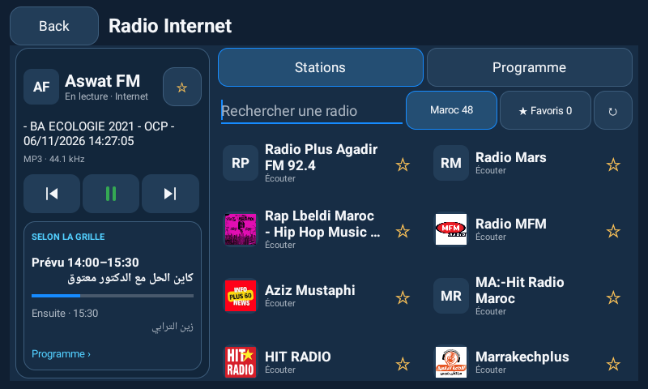
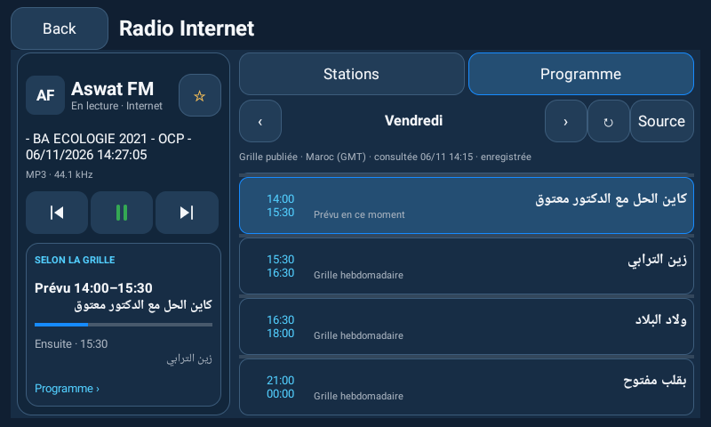

# Radio et programmes publiés — 1.9.0

La demande porte sur les programmes **radio**, pas sur un guide IPTV. L’EPG est distinct du titre transmis par un flux audio : celui-ci peut donner un morceau ou une émission, sans fournir un horaire ou le programme suivant.

## Couverture vérifiée le 6 novembre 2026

| Station | Source inspectée | Intégration |
| --- | --- | --- |
| Aswat / Aswat FM | [Grille hebdomadaire officielle](https://radioaswat.ma/#grille) | Lecture native de sept jours et des créneaux publiés. Le contrôle a trouvé 53 entrées. Nombre et contenu peuvent changer chez le diffuseur. |
| HIT RADIO | [Site officiel](https://www.hitradio.ma/) | Pas de grille horaire structurée compatible identifiée dans les pages et ressources publiques consultées. Le programme est indiqué comme non intégré. |
| Radio Mars | [Page officielle des programmes](https://radiomars.ma/%d8%a8%d8%b1%d8%a7%d9%85%d8%ac%d9%86%d8%a7/) | La page consultée présente des contenus d’émissions, sans grille horaire structurée exploitable par cet adaptateur. Aucun horaire n’est déduit des dates d’articles. |
| MFM | [Site officiel](https://mfmradio.ma/) | Le site HTTPS a échoué à la vérification TLS avec un certificat expiré, y compris sur l’hôte `www`. Aucune désactivation de la vérification TLS n’est ajoutée. Pas d’adaptateur intégré pour cette source. |
| Autres stations du catalogue | Métadonnées Radio Browser | Un nom ressemblant à une radio connue ne suffit pas à lui attribuer un EPG. Une source compatible doit être identifiée pour son flux. |

Il ne s’agit pas d’une affirmation qu’aucun autre fournisseur ne propose ces grilles. Cette version n’intègre que la source structurée vérifiée. La correspondance utilise les hôtes/chemins connus des flux principaux ; une web-radio de genre ou une station au nom similaire ne reçoit pas automatiquement le guide d’une autre antenne. Aswat reste proposée dans le catalogue même si l’annuaire ne la retourne pas.

## Utilisation

1. Dans Radio, la loupe ou le raccourci **Media** ouvre le lecteur agrandi de la source choisie.
2. **Stations** conserve la recherche, les logos disponibles, Maroc/Favoris et les commandes précédente/suivante.
3. Choisir Aswat, puis **Programme**, affiche la semaine publiée. Les flèches changent de jour ; toucher le nom du jour revient à aujourd’hui. **Source** ouvre explicitement le site officiel ; **↻** tente de renouveler le guide pris en charge.
4. Le panneau de lecture indique le titre reçu du flux s’il existe et le format audio lorsqu’ExoPlayer le fournit. Il n’invente ni fréquence FM, ni puissance de signal, ni morceau.

La vue large place le lecteur à gauche et le catalogue/guide à droite. Sur un affichage plus dense ou étroit, les commandes restent en bandeaux et le guide utilise la largeur disponible. Les touches conservent une cible d’au moins 48 dp. Un changement vers Programme ferme le clavier et restitue les commandes de lecture. L’accueil Maps/Media conserve sa structure et ses quatre raccourcis.

Les logos restent ceux réellement accessibles auprès des sources du catalogue. Le favicon WordPress générique observé pour Aswat est remplacé par les initiales de la station, sans inventer un logo.

## Sens des horaires

**« Selon la grille », « Prévu » et « Ensuite » sont des prévisions issues de la grille hebdomadaire affichée par le diffuseur.** Ce ne sont pas une confirmation de ce qui passe effectivement à l’antenne. Une émission spéciale, un événement sportif ou une modification non publiée peut changer la diffusion. Le titre réellement reçu du flux reste séparé de ces prévisions.

La barre bleue représente l’avancement du créneau publié selon l’horloge, pas une position de lecture ou une fonction de retour arrière. Un trou horaire n’est pas rempli avec une émission inventée ; deux créneaux se chevauchant ne produisent pas un choix arbitraire. Minuit et le passage d’une semaine à l’autre sont traités explicitement. Le prochain créneau porte un jour lorsqu’il ne tombe pas aujourd’hui.

L’heure légale marocaine est GMT depuis le 20 septembre 2026, avec un recul d’une heure à 02:00 ancienne heure locale : [communiqué officiel du 18 septembre 2026](https://www.cg.gov.ma/fr/node/13036). Le module applique cette règle à partir de son entrée en vigueur pour éviter une ancienne règle GMT+1 dans une base de fuseaux Android 13. Il ne change ni l’heure, ni le fuseau, ni les réglages système du poste. Une modification future de cette règle devra être prise en compte dans une mise à jour du logiciel.

## Réseau, cache et confidentialité

- Requête publique HTTPS vers l’origine autorisée d’Aswat, sans connexion à un compte, cookies ou identifiants. Aucun contact, GPS ou compte Google n’est transmis au diffuseur.
- Lecture hors du thread UI, réponse bornée à 2 Mio, au plus 500 créneaux, délais de connexion/lecture de 7/10 secondes et redirections limitées aux hôtes HTTPS autorisés. Aucun script de la page n’est exécuté pour importer le guide.
- Cache JSON privé avec source et date de consultation. Actualisation au plus toutes les six heures en usage normal, ou sur demande explicite. Les erreurs conservent un cache existant ; une nouvelle tentative automatique est espacée d’au moins cinq minutes.
- Une grille enregistrée reste consultable hors connexion avec son statut et sa date. Les indications « prévu maintenant » / « ensuite » ne sont plus produites à partir d’une consultation vieille de plus de 24 heures, ou d’une date incohérente dans le futur. **La date de consultation n’est pas une date de mise à jour annoncée par la radio.**
- Le logiciel ne réhéberge pas le flux audio et ne publie pas la grille complète comme fichier statique dans le dépôt. Les titres et horaires sont lus auprès du site pour l’utilisateur, avec accès à la source.

Le parseur HTML [jsoup 1.24.1](https://jsoup.org/download) est utilisé ; sa licence MIT est incluse dans l’APK (`META-INF/jsoup/LICENSE`). Aucune nouvelle permission Android n’est nécessaire.

## Vérification et limites

Les [résultats de tests](TEST-RESULTS.md) distinguent le téléchargement réel de la grille Aswat, les tests de calendrier contrôlés, les gestes UI, le cache et les tests du lecteur. Les captures sont celles d’un émulateur Android 13, pas du boîtier du propriétaire.

Les horaires restent sous la responsabilité du diffuseur. La présence de 53 créneaux lors du contrôle n’établit pas qu’ils reflètent chaque modification à l’antenne. Le réseau et la lisibilité réels de l’Incarlink, la qualité audio et les commandes physiques restent à valider sur ce matériel. Les fonctions de lecture en arrière-plan, de tuner FM Toyota et d’enregistrement ne sont pas ajoutées. Cette version ne modifie pas l’intégration Google Maps/YouTube ni leurs restrictions de compte.
