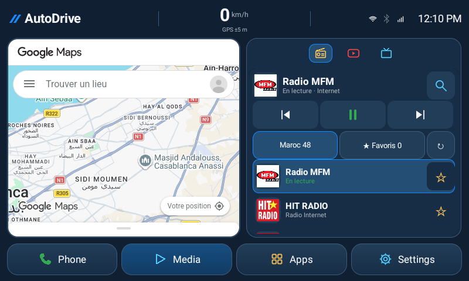
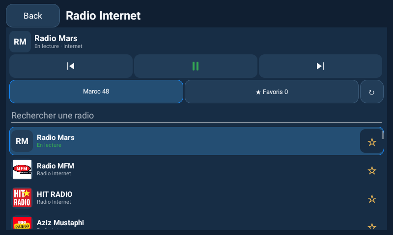
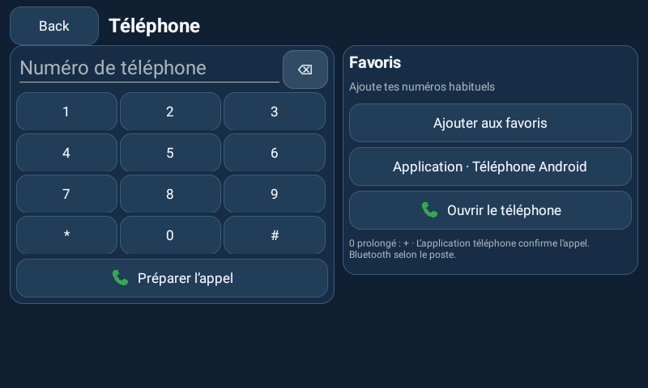

# Radio Internet et Téléphone — 1.6.1

## Radio

Le propriétaire a choisi les stations Internet et demandé les radios du Maroc. L’onglet Radio utilise maintenant un lecteur audio natif Media3. Il ne dépend pas d’une application radio externe ou du tuner Toyota.

L’onglet **Radio** charge le catalogue du pays `MA` de Radio Browser et affiche la liste directement dans son panneau. Chaque ligne montre le logo fourni lorsqu’il est disponible, le nom, l’état réel de sélection/lecture et l’étoile de favori. Choisir une station l’enregistre et commence sa lecture. Le filtre **Maroc** donne accès au catalogue et aux radios personnelles enregistrées ; **Favoris** limite la liste aux favoris. Précédente/suivante utilise cette même source et boucle dans les deux directions. Une recherche filtre l’affichage ; le parcours reste celui du filtre Maroc/Favoris choisi.

La **loupe** ouvre la liste agrandie avec recherche. Les contrôles du lecteur se replient pendant la saisie pour laisser de la place aux résultats. Dans le petit panneau à densité élevée, les commandes et la liste ont priorité ; la loupe donne accès à la recherche et aux filtres. Les flux personnels peuvent être ajoutés et gérés dans **Réglages → Stations radio Internet**. Limite : 200 stations enregistrées. [Constats et corrections de l’audit](RADIO-AUDIT.md).

Les URL de logos sont conservées avec le catalogue et les préférences. Un ancien cache sans ces champs est utilisable puis actualisé. Les doublons d’un flux partagent les métadonnées disponibles. Les images sont chargées uniquement en HTTPS, avec délais, au plus deux tâches IO simultanées, limite de 512 Kio par réponse, décodage sous-échantillonné à 128 pixels maximum, cache mémoire de 2 Mio et cache disque borné à 64 fichiers/12 Mio. Aucun téléchargement ne bloque le thread UI. Images manquantes, refusées, SVG non décodable ou autres erreurs donnent les initiales de la station ; aucun logo de remplacement ressemblant à une marque n’est généré. Les métadonnées de l’annuaire peuvent être erronées ; un lien de logo personnel peut être renseigné dans la modification d’une station.

Le catalogue est communautaire : il ne garantit ni l’exhaustivité des radios marocaines, ni l’authenticité de chaque entrée, ni la disponibilité ou les droits de chaque flux. La requête demande les entrées annoncées fonctionnelles ; AutoDrive conserve les URL résolues HTTPS valides, sans identifiants intégrés. Certains flux HTTPS utilisent un port spécifique, qui est pris en charge. Les flux uniquement HTTP ne sont pas chargés et ne sont pas automatiquement réécrits en HTTPS. La source de l’annuaire apparaît dans l’interface. [API et champs Radio Browser](https://docs.radio-browser.info/).

Les métadonnées du catalogue sont mises en cache dans le stockage privé. **Actualiser** tente de les renouveler, avec un second serveur en cas d’échec. Une panne conserve le dernier catalogue utilisable et les stations enregistrées. Les appels réseau se font hors du thread UI, avec délais et taille maximale de réponse. Aucun compte, GPS ou contact n’est envoyé à l’annuaire ; les serveurs d’annuaire et de diffusion reçoivent les informations habituelles d’une connexion réseau. Aucun vote ou compteur de clic n’est envoyé par AutoDrive.

HIT RADIO est proposé par défaut avec le flux HTTPS utilisé par le lecteur de son [site officiel](https://hitradio.ma/?lang=fr), vérifié le 6 novembre 2026 : `https://hitradio-maroc.ice.infomaniak.ch/hitradio-maroc-128.mp3`. Cette vérification n’accorde pas une licence générale de redistribution de contenu. L’application lit directement le flux et ne réhéberge pas l’audio ou les logos.

Le lecteur utilise le focus audio Android et se met en pause lors d’un changement de sortie signalé par Android. Les pistes vidéo sont désactivées. MP3/AAC et HLS sont traités par les composants Media3 existants, selon les codecs disponibles. Le statut « En lecture » dépend de `Player.isPlaying`, et un titre de morceau n’apparaît que lorsque le flux fournit réellement cette métadonnée. Une erreur propose de réessayer avec le bouton de lecture. Aucune barre d’avancement fictive n’est affichée pour un flux en direct. [Événements Media3](https://developer.android.com/media/media3/exoplayer/listening-to-player-events), [focus audio](https://developer.android.com/media/optimize/audio-focus).

La radio reste active dans les pages internes Téléphone et Réglages. Quitter AutoDrive, passer à une autre application, changer d’onglet média ou détruire l’activité libère le lecteur. Au retour ou au redémarrage, la station reste sélectionnée mais la lecture ne reprend pas automatiquement. Il n’y a pas de service permanent, de lecture en arrière-plan ou d’intégration des commandes au volant revendiquée.

## Téléphone

Le raccourci Phone ouvre un clavier et six favoris locaux. Appui prolongé sur 0 : `+` ; appui prolongé sur effacement : vider ; un favori remplit le clavier et un appui prolongé propose sa suppression. Les noms et numéros saisis restent dans les préférences privées de l’application ; AutoDrive ne lit pas le carnet d’adresses ou le journal des appels.

**Réglages → Application Téléphone** ou le bouton dans cette page permet de choisir l’application installée du téléphone ou du boîtier. **Ouvrir le téléphone** lance cette application. **Préparer l’appel** utilise `ACTION_DIAL` et une URI `tel:` correctement encodée, limitée au paquet choisi lorsqu’un choix existe. Une application absente ou ne recevant pas ce type d’intent produit un message explicite ; aucun autre composeur n’est choisi silencieusement. Le choix Téléphone Android rétablit la résolution normale du système. [Intents téléphoniques Android](https://developer.android.com/guide/components/intents-common#Phone).

L’utilisateur confirme ensuite l’appel dans le composeur. AutoDrive ne demande pas `CALL_PHONE`, ne devient pas composeur par défaut et n’ajoute pas d’InCallService. Répondre, raccrocher, gérer le micro et router un appel Bluetooth restent les fonctions de l’application Téléphone et du firmware. Ouvrir un composeur sur un téléphone ne démontre pas qu’un boîtier Android peut appeler via le téléphone Bluetooth : ce point nécessite un essai sur l’Incarlink.

